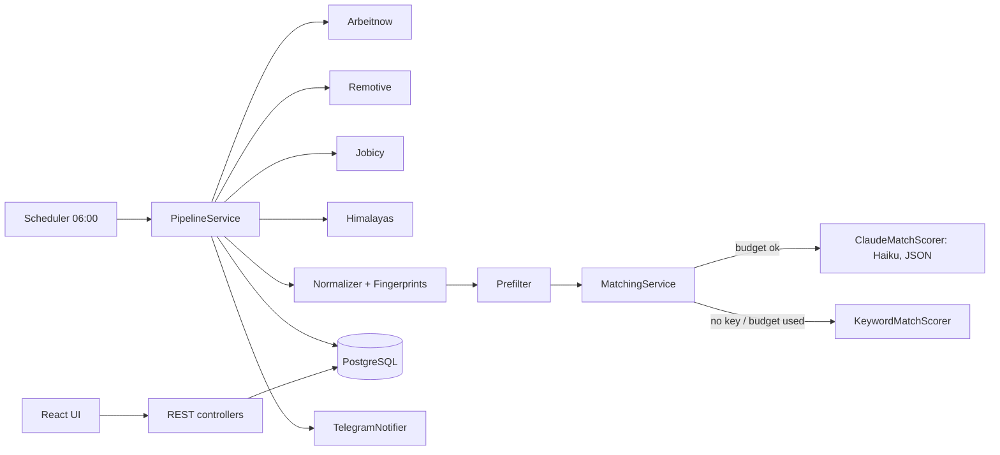

# JobRadar

Looking for a junior job means checking several job boards every day and reading hundreds of ads that do not fit. JobRadar does this automatically: every morning it collects new vacancies from open job APIs across Europe, drops the ones that clearly do not fit, scores the rest against my CV with AI and shows me the best matches with an explanation.

**Live:** public showcase - https://boris-plotnikov.click/jobradar/#/showcase (no login; personal data is hidden)


## Quick tour

1. Open the **showcase**: counters of the last 30 days, the best matches with scores, the five pipeline steps.
2. **AI inside**: pick a job and see the exact prompt, the JSON schema the model must follow, its answer and what the call cost.
3. Press **`</> Under the hood`** (bottom right, on every screen): each feature as a chain of real code, controller → service → repository → test, plus a live list of the API calls the page makes.
4. Scroll to **Market insights**: most requested skills for junior roles, countries, salaries, skills missing in my CV.
5. Owner view (private): feed with filters, vacancy page with strengths and gaps, cover letter in EN/DE, applications board.

## Features

| Area | What it does |
|---|---|
| Sources | Arbeitnow, Remotive, Jobicy, Himalayas: official public APIs, no keys. One class per source behind the `JobSource` interface |
| Normalization | Country and city from free text, remote/hybrid/on-site, language of the ad (EN/DE), 40 technologies extracted |
| Duplicates | Fingerprint of company + title + country, plus title similarity (Jaccard) within the same company |
| Prefilter | Stop words (senior, lead…), "5+ years", countries, remote only, keywords - with a readable reason |
| Matching | Claude Haiku, structured JSON output (`score`, `summary`, `strengths`, `gaps`, `advice`), validated before saving. Fallback: keyword scoring |
| Cost control | Prompt caching of the CV, per-run AI limit, monthly budget, every call logged with tokens and cost |
| Applications | Kanban Saved → Applied → Interview → Offer / Rejected, notes, follow-up reminder after 10 days |
| Cover letters | Claude Sonnet with adaptive thinking, English or German. The prompt gets the CV, the vacancy, the match analysis (strengths and gaps) and verified portfolio facts; it picks the 2-3 key requirements and backs each with evidence. Editable templates in the database, version history, a plain template when AI is unavailable |
| Insights | Skills, countries, work modes, languages, salaries, weekly trends, CV coverage |
| Digest | Telegram message with the best new matches (optional) |
| Showcase | Public read-only page for employers, with the AI request trace |
| Code tour | Snippets of the real source code, extracted at build time by `frontend/scripts/codetour.mjs`; the build fails if a referenced method disappears |

## Architecture



Package by feature: `source`, `vacancy`, `matching`, `pipeline`, `application`, `letter`, `insights`, `showcase`, `settings`, `notify`, `config`. Each feature has its entity, repository, service and controller. Decisions: [docs/adr](docs/adr).

## Tech stack

Java 21 · Spring Boot 3.5 (Web, Data JPA, Security, Validation, Scheduling) · PostgreSQL 16 · Flyway · Anthropic Java SDK · JUnit 5 · H2 for tests · React + TypeScript (Vite, Tailwind, Recharts) · Docker · GitHub Actions

The frontend was built by an external developer to my specification ([docs/frontend-brief.md](docs/frontend-brief.md)) and under my review.

## Run locally

```bash
cp .env.example .env            # set DB and owner password; ANTHROPIC_API_KEY is optional
cd frontend && npm install && npm run build && cd ..
cd backend && mvn spring-boot:run
```

Open http://localhost:8101 - API docs at `/swagger-ui.html`. Or everything at once: `docker build -t jobradar .`

## Tests

```bash
cd backend && mvn test
```

43 tests: parsing of real API answers (saved fixtures), normalization, duplicates, prefilter rules, keyword scoring, validation of AI answers, cost calculation, the full pipeline with a fake source on H2, security (login, CSRF, private vs public API), applications and letters through the REST API.

## Data and terms

Only official public APIs are used, no scraping of LinkedIn, StepStone or Indeed. Every vacancy links to the original ad and names its source, as the API terms ask.

## About

Built by Boris Plotnikov. This is my real job search tool.

AI tools were used to review code and speed up routine work. The design, the business rules and the tests are my own, and I can explain every part of the code.
